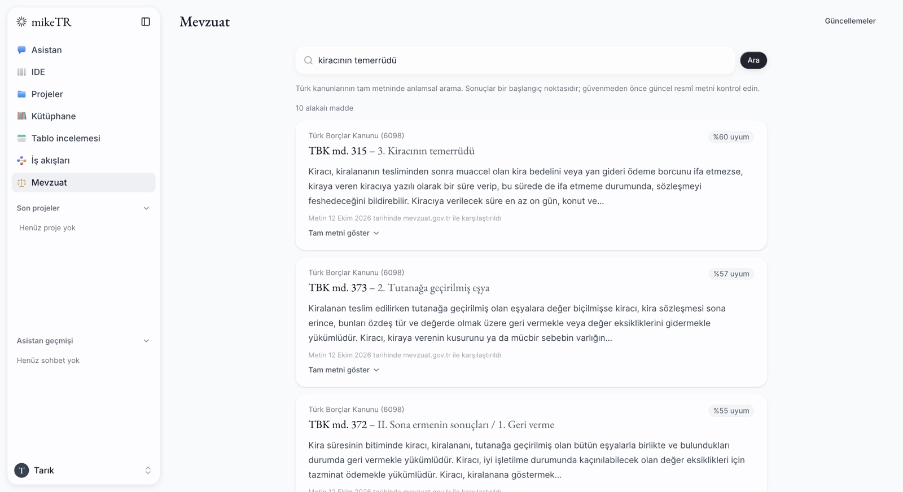
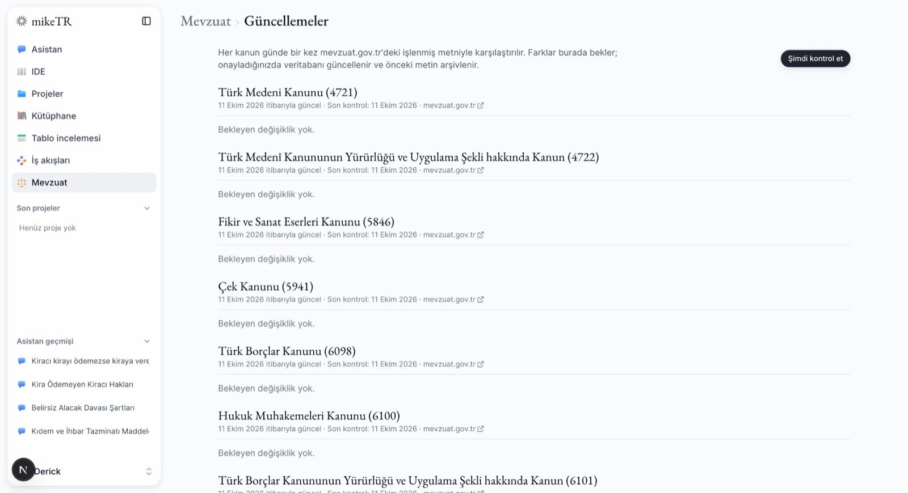
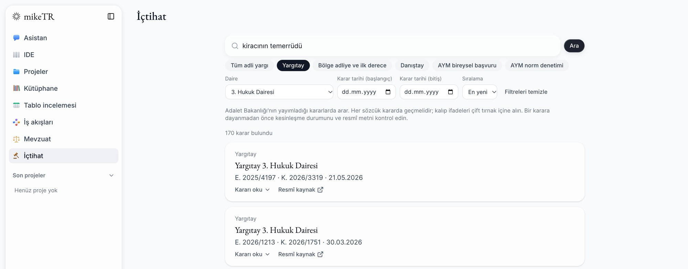
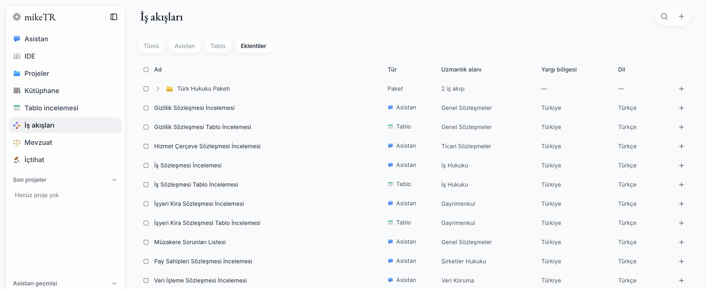

# mikeTR

[Türkçe](README.md) | **English**

An open-source AI assistant for Turkish lawyers. It reviews your documents,
drafts, and researches Turkish legislation and case law. It runs on your own
computer.

mikeTR is built on [Mike](https://github.com/willchen96/mike), an open-source
legal AI platform. On top of Mike's document review, editing, tabular review and
workflow features, it adds a Turkish interface, Turkish statute and case law
search, and workflows adapted to Turkish law.

> **Important:** mikeTR is not a substitute for legal advice. Always check the
> currency of statutes and the assistant's answers against the official sources.









## Features

- **Turkish interface:** every screen of Mike is translated into Turkish.
- **Statute search:** semantic search over the full text of 42 laws. Describe an
  issue in plain words ("kiracının temerrüdü") or type a citation such as
  "HMK 107" or "TBK md. 49".
- **Case law search:** decisions of the Court of Cassation (Yargıtay),
  including reversals in the interest of the law (kanun yararına bozma), the
  Council of State (Danıştay) and the Constitutional Court (individual
  applications and constitutional review), plus regional appeal and
  first-instance decisions published in UYAP Emsal. Filter by chamber, decision
  date and finality, read the full text and open the official page. Before
  citing a decision, the assistant finds and reads it, and takes the citation
  (chamber, docket and decision numbers, date) from the official source, never
  from memory.
- **Answers grounded in the law:** the assistant searches for the relevant
  article before stating a legal rule. Every statute and case citation in an
  answer is checked against the sources actually read in that chat and marked.
- **Currency check:** the statutes are compared with mevzuat.gov.tr every day.
  Changes are applied only after you approve them, and the old text is archived.
- **Workflows adapted to Turkish law:** contract reviews, tabular reviews, a
  legal research memo and a draft formal notice (ihtarname)
  ([skraptt/mike-workflows-tr](https://github.com/skraptt/mike-workflows-tr)).
- **Calculations:** deadlines under HMK/İİK/CMK/TBK (holidays and judicial
  recess included), statutory and commercial default interest (Law 3095) and
  court fees at filing, on the Calculations page and as assistant tools.
- **Petition templates:** under Library > Preset templates > mikeTR: formal
  notices, objection to a payment order, annulment of objection, rent
  determination, eviction, statement of defence and appeal petitions (fields to
  fill are highlighted; a lawyer must review them).
- **UYAP UDF:** upload .udf files, and download Word documents as .udf for
  filing through UYAP (text, formatting, alignment and tables).
- **Mike's features:** chat with documents, apply suggested edits, tabular
  document review, projects and folders.
- **Bring your own key:** add an Anthropic (Claude), Google (Gemini) or OpenAI
  key in Settings, or run models entirely on your computer with Ollama.

### Laws covered

42 laws, about 9,000 articles:

| Area | Laws |
|---|---|
| Civil law and obligations | Civil Code (4721) and its Implementation Law (4722), Code of Obligations (6098) and its Implementation Law (6101), Condominium Law (634), Land Registry Law (2644) |
| Commercial and IP | Commercial Code (6102) and its Implementation Law (6103), Cheque Law (5941), Capital Markets Law (6362), Competition Law (4054), Law on Intellectual and Artistic Works (5846), Industrial Property Law (6769) |
| Consumers and data | Consumer Protection Law (6502), Personal Data Protection Law (6698), Internet Law (5651) |
| Procedure, enforcement and the professions | Code of Civil Procedure (6100), Enforcement and Bankruptcy Law (2004), Mediation in Civil Disputes Law (6325), Notification Law (7201), Attorneys Law (1136), Notaries Law (1512) |
| Labour and social security | Labour Law (4857), the old Labour Law No. 1475 (article 14 on severance pay, still in force), Labour Courts Law (7036), Social Insurance and General Health Insurance Law (5510) |
| Criminal | Criminal Code (5237), Code of Criminal Procedure (5271), Law on the Execution of Sentences (5275), Misdemeanours Law (5326), Law No. 6284 on protection of the family and prevention of violence against women, Highway Traffic Law (2918) |
| Public law | Constitution (2709), Administrative Procedure Law (2577), Civil Servants Law (657), Expropriation Law (2942), Zoning Law (3194), Public Procurement Law (4734) |
| Tax | Tax Procedure Law (213), Income Tax Law (193), Value Added Tax Law (3065), Law on the Collection of Public Receivables (6183) |

For topics outside this set (for example the Fees Law or regulations), the assistant says plainly that its answer is not verified
against the database.

## Installation

### Requirements

- [Docker Desktop](https://www.docker.com/products/docker-desktop/) (Mac,
  Windows or Linux)
- At least 8 GB of memory and 20 GB of free disk space
- An API key from an AI provider (Anthropic, Google or OpenAI), or
  [Ollama](https://ollama.com) for local models

### Steps

1. Download the project and enter its folder:

   ```bash
   git clone https://github.com/skraptt/mikeTR.git
   cd mikeTR
   ```

2. Create the settings files:

   ```bash
   cp .env.example .env
   cp backend/.env.example backend/.env
   ```

3. Open `backend/.env` in a text editor:
   - Put two different random values on the `DOWNLOAD_SIGNING_SECRET` and
     `USER_API_KEYS_ENCRYPTION_SECRET` lines. Use the output of this command for
     each:

     ```bash
     openssl rand -hex 32
     ```

   - Put your own email address on the `KANUN_ADMIN_EMAILS` line. The account
     that signs in with this address approves statute updates.

4. Start it:

   ```bash
   docker compose up --build
   ```

   The first start takes 10–20 minutes: the app is built and the search model
   (BGE-M3, about 1.2 GB) is downloaded. Statute texts and their vectors ship
   with the project and are not recomputed. Later starts take a few seconds.

5. Open <http://localhost:3000> and create an account with **Kayıt ol**
   (Sign up).

6. The confirmation email does not go to your real inbox; it lands in a test
   mailbox on your computer. Open <http://localhost:8025> and click the link in
   the email.

7. Sign in and add your AI provider's API key under **Ayarlar** (Settings).

To stop, press **Ctrl + C** in the terminal or run `docker compose down`. Your
data is kept; `docker compose up` picks up where you left off.

### Updating

```bash
git pull
docker compose up --build
```

## Where is your data?

In a local install, your documents, chats and account are stored only inside
Docker on your own computer. The only thing that leaves it is the text and
documents you send to the assistant, which go to the AI provider you choose.

If you work with client data, make sure the provider does not use it for
training and that its terms comply with KVKK art. 9 (transfers abroad) and a
lawyer's duty of confidentiality. If data must never leave your computer, use a
local model with Ollama.

### Telemetry (error reports)

mikeTR sends no error reports by default. To send reports to your own Sentry
project, set `SENTRY_DSN` (server) and `FRONTEND_SENTRY_DSN` (web app). With
`SENTRY_DISABLED=false`, reports go to the US-hosted Sentry of the upstream Mike
project instead. Reports never contain document content or credentials; see
[observability.md](docs/observability.md). Consider the KVKK art. 9 rules on
transfers abroad before turning this on.

## Server installation

To run mikeTR on a server for your team, follow
[deploy/README.md](deploy/README.md).

## Development

- To add a law, list it in `backend/src/lib/kanunList.ts`, then run
  `npm run kanun:fetch` and `npm run kanun:embed`.
- To re-import statute texts, compute vectors and compare with mevzuat.gov.tr,
  `backend/` has `npm run kanun:import`, `npm run kanun:embed` and
  `npm run kanun:check`.
- To regenerate the bundled data package
  (`backend/setup-data/kanun-maddeleri.csv.gz`) from the current database:
  `npm run kanun:snapshot`.
- Mike's own documentation: [README.mike.md](README.mike.md) and
  [docs/](docs/README.md).

## License

Like Mike, mikeTR is licensed under the
[GNU Affero General Public License v3.0](LICENSE). If you make a modified
version available to others, you must share its source code too. Statute texts
are official texts and may be used freely under FSEK art. 31. Thanks to Mike and
the open-source projects it uses: [CREDITS.md](CREDITS.md).
